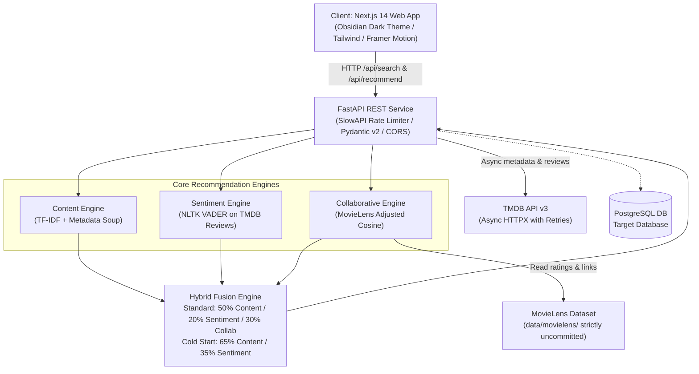

# FilmMatch AI — Intelligent Hybrid Movie Recommendation Platform

FilmMatch AI is a full-stack, transparent, and explainable movie recommendation engine combining **Content-Based Story DNA (TF-IDF)**, **Audience Sentiment Analysis (NLTK VADER)**, and **Collaborative Filtering (MovieLens)**. It delivers ranked recommendations with complete mathematical breakdown, giving explicit first-class support to Indian regional cinema (**Telugu `te`, Hindi `hi`, Tamil `ta`, Malayalam `ml`, Kannada `kn`**) alongside global cinema.

---

## 📽️ Features

- **Tripartite Hybrid Recommendation Engine**:
  - **Narrative DNA (Content Similarity)**: Metadata soup combining directors, top cast, genres, plot overview, thematic keywords, and language anchors with TF-IDF bi-grams and cosine similarity.
  - **Audience Sentiment Pulse (VADER)**: Analyzes real TMDB viewer reviews (not professional critics) to quantify authentic audience reception normalized to `[0.0, 1.0]`.
  - **Behavioral Community Affinity (MovieLens CF)**: Adjusted item-item cosine similarity using mean-centered ratings from 100,000+ ratings across 610 users, verified strictly through `links.csv`.
- **Explainability & Transparency**:
  - Every recommendation includes an exact score breakdown (content similarity, audience sentiment, collaborative score) and human-readable explanation rationale.
- **Cold-Start Resilience**:
  - Automated detection of unmapped regional or brand-new titles, dynamically reweighting to Content ($0.65$) + Sentiment ($0.35$) with clear badge indicators.
- **Cinematic Dark UI**:
  - Obsidian-grade dark interface built with Next.js 14, Tailwind CSS, Framer Motion, and Lucide icons.
- **Production Hardened Backend**:
  - FastAPI service with strict Pydantic schemas, `slowapi` rate limiting, exponential backoff retries, and comprehensive error resilience.

---

## 📐 Architecture & System Topology



---

## 📋 Prerequisites

- **Python**: `>= 3.11` (Tested on Python 3.12 / 3.14)
- **Node.js**: `>= 18.17.0` (LTS recommended, e.g. Node 20 or 24)
- **Package Managers**: `pip` (or `uv`) and `npm`
- **TMDB API Credentials**: Free API Key or Read Access Token from [The Movie Database](https://www.themoviedb.org/documentation/api)

---

## ⚙️ Environment Variables

Copy `.env.example` to `.env` in the project root:

```bash
cp .env.example .env
```

| Variable Name | Required | Default | Description |
| :--- | :---: | :---: | :--- |
| `TMDB_API_KEY` | Conditional | `""` | TMDB v3 API Key (either Key or Read Token required) |
| `TMDB_READ_ACCESS_TOKEN` | Conditional | `""` | TMDB v4 Bearer Read Access Token |
| `DATABASE_URL` | Optional | `""` | PostgreSQL connection URL (e.g., `postgresql+asyncpg://...`) |
| `ENVIRONMENT` | No | `development` | Environment mode (`development` / `production`) |
| `BACKEND_PORT` | No | `8000` | Port for the FastAPI server |
| `FRONTEND_PORT` | No | `3000` | Port for the Next.js dev server |
| `RATE_LIMIT_PER_MINUTE` | No | `60` | SlowAPI rate limit per client IP |

> **Security Note**: Never commit `.env` or expose API keys. The `.gitignore` prevents tracking `.env` files.

---

## 📥 Ingesting MovieLens Dataset (Do Not Commit)

MovieLens data is required for the collaborative filtering engine. It is strictly excluded from version control.

1. Download the `ml-latest-small.zip` dataset (~1 MB) from GroupLens:
   ```bash
   # Linux/macOS:
   curl -O https://files.grouplens.org/datasets/movielens/ml-latest-small.zip
   unzip -q ml-latest-small.zip -d data/
   mv data/ml-latest-small data/movielens
   rm ml-latest-small.zip

   # Or run the included Python ingestion tool:
   python tools/fetch_movielens.py
   ```
2. Verify that `data/movielens/` contains `links.csv`, `movies.csv`, and `ratings.csv`.
3. Verify `links.csv` mapping integrity:
   ```bash
   python tools/verify_movielens_mapping.py
   ```

---

## 🚀 Setup & Running Locally

### 1. Backend Setup

```bash
# From workspace root
python -m venv .venv

# Activate venv:
# Windows:
.venv\Scripts\activate
# Linux/macOS:
source .venv/bin/activate

# Install dependencies:
pip install -r requirements.txt

# Start FastAPI server:
uvicorn backend.main:app --reload --host 127.0.0.1 --port 8000
```
Backend API interactive documentation is available at: `http://127.0.0.1:8000/docs`

### 2. Frontend Setup

```bash
# From workspace root
cd frontend

# Install Node dependencies:
npm install

# Start development server:
npm run dev
```
Open `http://localhost:3000` in your browser.

---

## 🧪 Running Tests

### Backend Tests
```bash
# Run all unit and integration tests with pytest:
pytest tests/ -v
```

---

## 📡 API Endpoint Reference

| Method | Endpoint | Description | Rate Limit |
| :--- | :--- | :--- | :--- |
| `GET` | `/api/health` | Healthcheck & service status | None |
| `GET` | `/api/search?q={query}` | Search & autocomplete movies by title | 60/min |
| `POST` | `/api/recommend` | Generate explainable hybrid recommendations | 30/min |
| `GET` | `/api/movie/{id}` | Retrieve individual film details and score preview | 60/min |

### Recommendation Request Example (`POST /api/recommend`):
```json
{
  "query": "RRR",
  "tmdb_id": 579974,
  "top_k": 10
}
```

---

## 📜 Compliance, Citations & Attributions

### The Movie Database (TMDB)


*This product uses the TMDB API but is not endorsed or certified by TMDB.* All movie artwork, overview text, and credits are provided courtesy of TMDB.

### MovieLens Citation
The collaborative filtering engine incorporates MovieLens research datasets provided by GroupLens Research at the University of Minnesota. MovieLens is licensed strictly for non-commercial research use:
> F. Maxwell Harper and Joseph A. Konstan. 2015. *The MovieLens Datasets: History and Context.* ACM Transactions on Interactive Intelligent Systems (TiiS) 5, 4: 19:1–19:19. https://doi.org/10.1145/2827872

### License
This repository is licensed under the [MIT License](LICENSE).

---

## 🚦 Project Status

| Phase | Description | Status |
| :--- | :--- | :---: |
| **Phase 1** | Blueprint & Constitution (`gemini.md`) | ✅ Complete |
| **Phase 2** | Link (TMDB, MovieLens Ingestion, VADER Setup) | ✅ Complete |
| **Phase 3** | Architect (ML Engines, FastAPI Backend, Fusion) | ✅ Complete |
| **Phase 4** | Stylize (Next.js 14 Obsidian Cinematic Frontend) | ✅ Complete |
| **Phase 5** | Trigger (End-to-End Latency & Browser Verification) | ✅ Complete |
| **Phase 6** | Hygiene, Security & Backend Hardening | 🔄 In Progress |
| **Phase 7** | Recommendation Quality & Multilingual Evaluation | ⏳ Planned |
| **Phase 8** | PostgreSQL Provisioning & Query Acceleration | ⏳ Planned |
| **Phase 9** | Comprehensive Test Suite, Docker & GitLab CI | ⏳ Planned |
